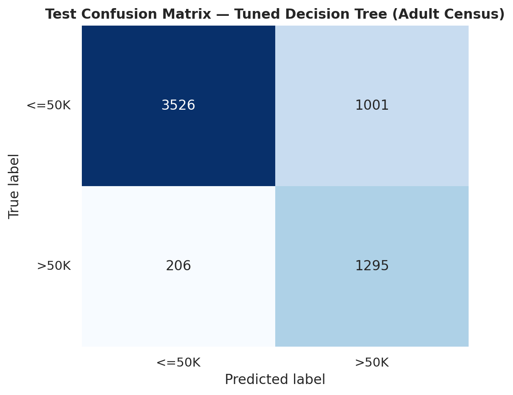

<div align="center">

# 🧪 ModelBench | Machine Learning Performance Evaluation

### Comparing predictive models, interpreting their decisions, and examining where they fail

   

**University group project · Comparative machine learning study**

</div>

---

## 🎯 Project overview

ModelBench is a comparative investigation of **Decision Trees, Support Vector Machines (SVM), k-Nearest Neighbours (kNN), Inductive Logic Programming (ILP), and Q-learning**. The project uses classification tasks to explore how different learning paradigms behave, how their outputs can be evaluated, and what trade-offs emerge beyond headline accuracy.

The experiments cover **Titanic passenger survival** and **Adult Census income classification**; the kNN component also includes **Iris**. The work combines preprocessing, model training, tuning, classification reports, confusion matrices, and visual analysis.

> **Research question:** How do different machine learning approaches compare on structured classification tasks, and what do their errors reveal about model suitability?

## 🔬 Experimental scope

| Approach | Task / dataset | What is examined |
|---|---|---|
| Decision Tree | Titanic; Adult Census | Interpretable splits, tuning, classification errors, feature importance |
| Support Vector Machine | Titanic; Adult Census | Margin-based classification and evaluation |
| k-Nearest Neighbours | Titanic; Adult Census; Iris | Instance-based classification across datasets |
| Inductive Logic Programming (Aleph) | Titanic; Adult Census | Logic-based learning using Prolog background knowledge |
| Q-learning | Titanic | Reinforcement-learning approach to a classification-style task; limitations of this formulation |

**Evaluation principle:** Accuracy alone is not enough. Confusion matrices, precision, recall and F1 help reveal class-specific errors; ROC and other plots are included where generated by the notebooks.

## 📊 Selected verified results

### Decision Tree — Adult Census (tuned model, test set)

The saved confusion matrix contains the following counts:

| Actual class | Predicted ≤50K | Predicted >50K |
|---|---:|---:|
| **≤50K** | 3,526 | 1,001 |
| **>50K** | 206 | 1,295 |

- **Test accuracy:** **79.98%** (4,821 correct predictions out of 6,028)
- **Interpretation:** The model made 1,001 false-positive predictions for the >50K category and 206 false-negative predictions. These error types deserve separate attention rather than relying only on accuracy.



Explore the accompanying [Adult Census Decision Tree output figures](Decision_Tree/outputs_adult/) for feature importance, ROC curves and other saved visualisations.

### Q-learning — Titanic

The repository's saved `classification_report.txt` and `results_summary.csv` report:

| Metric | Result |
|---|---:|
| Accuracy | **55.50%** |
| Precision (positive class) | **39.60%** |
| Recall (positive class) | **38.06%** |
| F1 (positive class) | **38.82%** |

**Confusion matrix:** `[[173, 90], [96, 59]]` (418 observations).

The saved run specifies **3,000 episodes**, learning rate **0.1**, discount factor **0.9**, and epsilon **0.1**. These results show substantial room for improvement. In particular, Q-learning applied to a static supervised classification dataset is not directly comparable to a conventional classifier without carefully defining states, actions, rewards and the evaluation protocol.

📄 [Q-learning classification report](Reinforcement_Learning/classification_report.txt) · [Saved metric summary](Reinforcement_Learning/results_summary.csv)

### Other models

SVM, kNN, ILP and additional Decision Tree experiments are included in their respective notebooks and output folders. **A single overall winner is not claimed here** because a consolidated, verified comparison under an identical evaluation protocol is not yet documented in this README.

## 🧠 What this project demonstrates

- **Model selection:** Different algorithms make different assumptions about data and decision boundaries.
- **Evaluation literacy:** Precision, recall, F1 and confusion matrices expose mistakes that accuracy can conceal.
- **Interpretability:** Decision-tree visualisations and feature importance make model behaviour easier to inspect.
- **Methodological caution:** Reinforcement learning and supervised learning need careful comparison rather than treating their scores as interchangeable.
- **Reproducibility:** Separate notebooks, saved figures and a setup guide make the experiments easier to review.

## 🗂️ Repository structure

```text
ModelBench-ML-Performance-Evaluation/
├── datasets/                 # Raw, cleaned and preprocessing resources
├── Decision_Tree/            # Titanic / Adult notebooks and output plots
├── SVM/                      # SVM experiments
├── kNN/                      # kNN experiments, including Iris
├── ILP/                      # Aleph / Prolog and logic-based experiments
├── Reinforcement_Learning/   # Q-learning code, report and saved metrics
├── SETUP.md                  # Environment and execution guide
├── README.md
└── LICENSE
```

## ⚙️ Getting started

**Requirements:** Python 3.x, Jupyter, NumPy, pandas, Matplotlib, seaborn and scikit-learn. **SWI-Prolog** is additionally required for ILP experiments.

```bash
git clone https://github.com/janani2075-ui/ModelBench-ML-Performance-Evaluation.git
cd ModelBench-ML-Performance-Evaluation
pip install numpy pandas matplotlib seaborn scikit-learn jupyter
jupyter notebook
```

Open the relevant notebook and run its cells in order. For the Q-learning Python implementation:

```bash
python Reinforcement_Learning/Janani_Q_Learning.py
```

For full instructions, see **[SETUP.md](SETUP.md)**. Note: some paths in the original group setup guide refer to the earlier university-hosted repository; use this GitHub repository path instead.

## ⚠️ Limitations and next steps

1. **Dataset differences:** Metrics from different datasets or splits should not be ranked as though they were directly comparable.
2. **Class imbalance and error costs:** Overall accuracy may hide meaningful differences in false positives and false negatives.
3. **Q-learning formulation:** The reinforcement-learning experiment requires a clearly justified state/action/reward design to support strong comparisons with supervised methods.
4. **Reproducibility:** Consolidate experiment settings, random seeds, preprocessing details and a unified results table in a future iteration.
5. **Further work:** Compare models on identical held-out splits, add cross-validation and uncertainty estimates, and investigate calibration and fairness where relevant.

## 👥 Project attribution

This repository presents **collaborative university coursework**. The Q-learning implementation and its saved report identify **Janani Veerakumar**. Other algorithm components are part of the wider group project; authorship of each component should be credited according to the original team records.

## 📬 Connect

**Janani Veerakumar** · MSc Data Science, University of Surrey

[](https://github.com/janani2075-ui)

---

<div align="center"><i>Evaluate the evidence. Understand the errors. Make better model decisions.</i></div>
